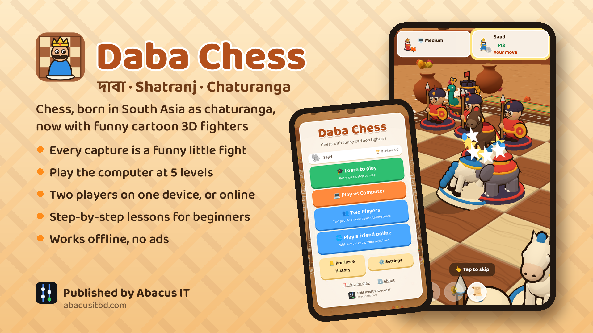
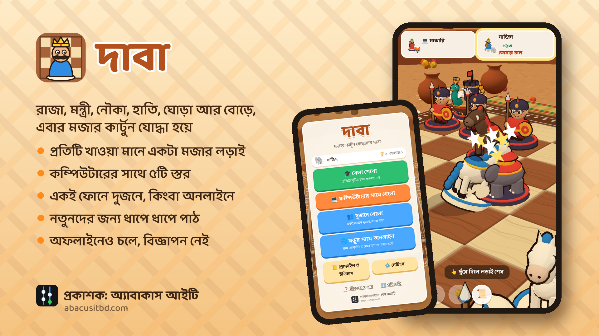

# Daba Chess (দাবা)

**Chess with funny cartoon 3D fighters: every capture is a little fight.** Chess was born in South Asia as
chaturanga; this is daba (shatranj) for Bangladesh, India, Nepal, Pakistan, Sri Lanka and everyone who loves chess.
Free, offline, no ads. By [Abacus IT](https://abacusitbd.com).

## Download

| Platform | Get it |
|---|---|
| **Play in the browser** (iPhone, iPad, any computer) | **[Play now](https://riadul.github.io/daba-chess-download/play/)** |
| **Android** 8+ | [DabaChess.apk](https://github.com/riadul/daba-chess-download/releases/latest/download/DabaChess.apk) (allow "install unknown apps" when asked) |
| **Windows** 10/11 | [DabaChess-Setup-x64.exe](https://github.com/riadul/daba-chess-download/releases/latest/download/DabaChess-Setup-x64.exe) |
| **Linux** | [Snap Store](https://snapcraft.io/daba-chess): `sudo snap install daba-chess`, or the AppImage / .deb on the [releases page](https://github.com/riadul/daba-chess-download/releases/latest) |

## About the game

Chess was born in South Asia about one and a half thousand years ago as chaturanga, the four parts of an army:
foot soldiers, horses, elephants and chariots. Daba Chess keeps the full rules and gives every piece a cartoon
character: the raja, the mantri (minister), the boat, the elephant, the horse and the little soldiers.

- Every capture is a short, funny fight (Full, Short or Off in Settings; a tap skips it)
- Full chess rules: castling, en passant, promotion with a choice of piece, check, checkmate and every draw rule
- Play the computer at 5 levels (Beginner, Easy, Medium, Hard, Expert), or a friend on one device
- Online play with a friend by room code
- 10 step-by-step lessons; a village courtyard, a palace terrace and a sunset field
- Profiles, statistics as white and as black, match history; saved after every move; undo, hints and a move list
- Fully offline, no ads, no account, no data collected; Bangla and English

**How to play:** white moves first, then the players take turns, one move each. Attack the other king so that it
cannot escape in any way: that is checkmate, and the game is won.

---

## বাংলায়

**মজার কার্টুন যোদ্ধাদের দাবা: প্রতিটি খাওয়া মানে একটা মজার লড়াই।** সম্পূর্ণ ফ্রি, অফলাইন, কোনো বিজ্ঞাপন নেই। প্রকাশক: [অ্যাবাকাস আইটি](https://abacusitbd.com)।

| কোথায় খেলবে | ডাউনলোড |
|---|---|
| **ব্রাউজারে** (আইফোন, আইপ্যাড, যেকোনো কম্পিউটার) | **[এখনই খেলো](https://riadul.github.io/daba-chess-download/play/)** |
| **অ্যান্ড্রয়েড** ৮ বা নতুন | [DabaChess.apk](https://github.com/riadul/daba-chess-download/releases/latest/download/DabaChess.apk) (জিজ্ঞেস করলে "অজানা অ্যাপ ইনস্টল" চালু করো) |
| **উইন্ডোজ** ১০/১১ | [DabaChess-Setup-x64.exe](https://github.com/riadul/daba-chess-download/releases/latest/download/DabaChess-Setup-x64.exe) |
| **লিনাক্স** | [স্ন্যাপ স্টোর](https://snapcraft.io/daba-chess): `sudo snap install daba-chess` |

- রাজা, মন্ত্রী, নৌকা, হাতি, ঘোড়া আর বোড়ে, আর প্রতিটি খাওয়া মানে একটা মজার লড়াই
- কম্পিউটারের সাথে ৫টি স্তর (নতুন, সহজ, মাঝারি, কঠিন, ওস্তাদ), অথবা একই ফোনে বন্ধুর সাথে
- রুম কোড দিয়ে বন্ধুর সাথে অনলাইন খেলা
- আসল বোর্ডে ধাপে ধাপে ১০টি পাঠ; নিজের প্রোফাইল, হিসাব আর খেলার ইতিহাস

**কীভাবে খেলবে:** সাদা আগে চালে, তারপর পালা করে একটি করে চাল। প্রতিপক্ষের রাজাকে এমনভাবে আক্রমণ করো যেন সে কোনোভাবেই
বাঁচতে না পারে: এটাই কিস্তিমাত।

*Keywords: chess, daba, daba chess, dabā, daba khela, bangla chess, shatranj, satranj, shatranj game, chaturanga, chaturangam, chadurangam, sathurangam, buddhibal, buddhichal, chess game, 3d chess, cartoon chess, battle pieces, board game, two player, offline, bangladesh, india, nepal, pakistan, sri lanka, দাবা, দাবা খেলা, দাবার ঘুঁটি, শতরঞ্জ, চতুরঙ্গ, দবা, शतरंज, शतरंज खेल, चतुरंग, बुद्धिबळ, बुद्धिचाल, شطرنج, شطرنج کا کھیل, શતરંજ, ਸ਼ਤਰੰਜ, ଶତରଞ୍ଜ, சதுரங்கம், చదరంగం, ಚದುರಂಗ, ചതുരംഗം, චෙස්*
